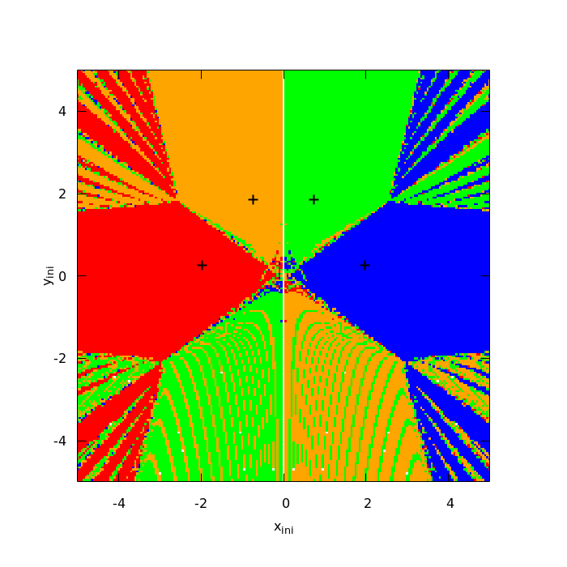
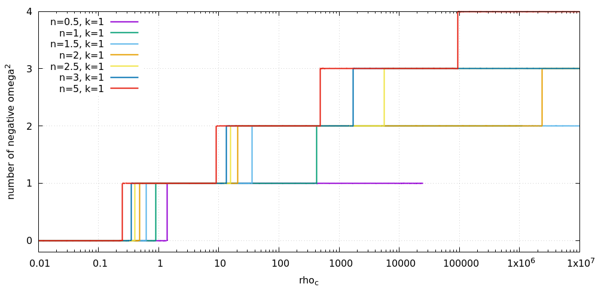

# Static_AdS

Static polytropic perfect-fluid stars in anti-de Sitter space, solved with the **W4 method**
([arXiv:1809.04495](https://arxiv.org/abs/1809.04495)), together with their radial stability.
The physical setup follows Lopes & Okawa, "Λ stars".

What the code does:

- solves the profile equations of a star (`g(x)`, `ρ(x)`, surface radius `x_S`, mass `M`) for a polytropic
  equation of state `P = k ρ^(1+1/n)`, with either the central density `ρ_c` or the mass `M` fixed;
- computes the radial perturbation spectrum `ω²` of every star and counts the unstable modes exactly
  (Sturm sequence on a tridiagonal eigenproblem);
- follows whole families of stars up to `ρ_c ~ 10⁷` and locates the points where stability changes.

The derivation of the equations, with checks, is in [`docs/derivation.html`](docs/derivation.html)
(open it in a browser; the equations are rendered with MathJax, which needs an internet connection).

## Results

Newton basins of the W4 method on the toy problem `x² + y² = 4, x² y = 1` (cf. Fig. 3 of the W4 paper):



Number of unstable radial modes along the sequence of stars (`k = 1`). Every new unstable mode appears at
an extremum of `M(ρ_c)`, and none is regained, so no island of stability shows up within the numerical
resolution (deep in the spiral the oscillations of `M` fall below the grid error):



More figures (per-family mass-radius spirals, behaviour of the modes at the stellar surface, ...) are in
[`docs/figures/`](docs/figures/) and explained in `docs/derivation.html`.

## Layout

```
static_ads/            the Python package
  w4.py                the W4 method (UDL decomposition, Jacobian, one iteration)
  star.py              profile equations, discretisation, solvers, command line
  stability.py         radial perturbation eigenproblem and stability test
  paths.py             where generated data goes
  tools/               runnable scripts (see below)
derivation/            sympy scripts that derive and check the equations (optional)
docs/                  derivation.html and the committed figures (docs/figures/)
data/                  all generated output; ignored by git
```

## Setup

```
uv sync            # Python 3.14+, numpy, scipy, sympy
```

[gnuplot](http://www.gnuplot.info/) is used for plots and is optional: without it the data files are still written.

## Usage

Everything is run from the repository root as a module. Output goes to `data/` (set the environment
variable `STATIC_ADS_DATA` to write somewhere else).

Solve one star, fixing the central density or the mass; `--n` and `--k` set the polytrope:

```
python -m static_ads.star --n 1 --k 1 --rho-c 1 --N 1000
python -m static_ads.star --n 1.5 --k 1 --mass 1e-3
```

This writes the profile, a plot and a summary to `data/runs/n<n>_k<k>_<...>/` and prints the radial stability.
For very high densities add `--grade 2` (graded mesh).

| Command (`python -m ...`)          | What it does                                                           |
|------------------------------------|------------------------------------------------------------------------|
| `static_ads.stability n k`         | `ω²` of the lowest modes along a `ρ_c` sequence → `data/stability/`      |
| `static_ads.tools.sweep`           | grid of `n`, `k`, `ρ_c` or `M`; comparison plots → `data/sweeps/`        |
| `static_ads.tools.scan_family`     | follow families to `ρ_c ~ 10⁷`, refine at stability points → `data/scan/` |
| `static_ads.tools.build_profiles`  | profiles and eigenmodes of selected stars of each scanned family        |
| `static_ads.tools.interactive_plot`| one zoomable HTML page with everything → `data/scan/scan_interactive.html` |
| `static_ads.tools.analyze_runs`    | stability of every stored run in `data/runs/` → `data/analysis/`         |
| `static_ads.tools.basin`           | Newton basins of the toy problem → `data/basin/`                         |
| `static_ads.tools.toy_example`     | W4 iteration history for the toy problem → `data/toy/`                   |
| `static_ads.tools.surface_figure`  | modes at the stellar surface → `data/figures/` (`--publish` copies to docs) |
| `static_ads.tools.publish_figures` | copy the figures used in the docs from `data/` to `docs/figures/`        |

Typical workflow for the interactive page:

```
python -m static_ads.tools.scan_family --n 1 1.5 3 5 --k 1 --rho-max 1e7 --N 2000
python -m static_ads.tools.build_profiles
python -m static_ads.tools.interactive_plot      # open data/scan/scan_interactive.html
```

Every tool has `--help` (or a usage line at the top of its file).

## Derivation scripts

`derivation/` holds the sympy scripts behind `docs/derivation.html`. Run them from that folder:

```
cd derivation
python static_background_check.py   # Einstein equations for the static star; confirms Eq. (4) and Eq. (5) with P
python linearize.py                 # linearised Einstein equations for the radial perturbation
python check_reduction.py           # checks the reduction to the Sturm-Liouville equation
```

## Notes

- The W4 step uses an *unpivoted* UDL decomposition. The order of unknowns and equations matters (a zero
  pivot otherwise); the choice used in `star.py` is explained in `Star`/`unpack`.
- Eq. (5) of the Lopes & Okawa draft has `ρ` where the Einstein equations give `P`; the code uses `P`
  (see Part I of `docs/derivation.html`).
- `docs/paper/` is git-ignored because the draft contains co-author comments.
